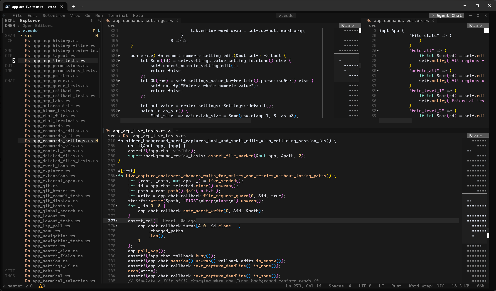
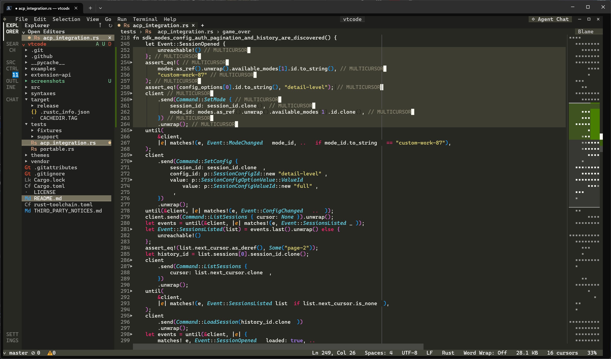
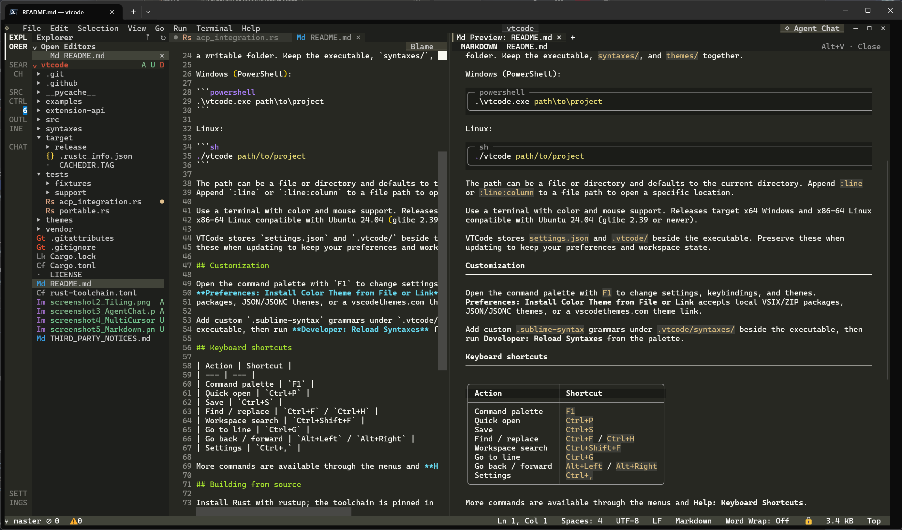
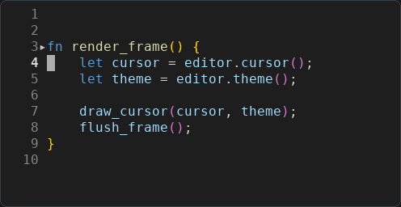
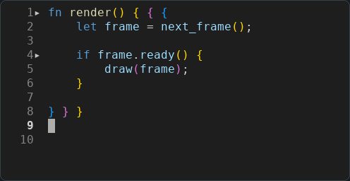

<div align="center">

# VTCode

**A VS Code–style editor that runs in your terminal.**

Fast, portable, written in Rust. Windows and Linux, locally or over SSH.

[](https://github.com/im-henri/vtcode/releases)
[](LICENSE)


[Download](https://github.com/im-henri/vtcode/releases) · [Quick start](#quick-start) · [Features](#features) · [Docs](#documentation)



</div>

> [!NOTE]
> VTCode is under active development. Expect frequent releases and the occasional rough edge.

## Why VTCode?

- **Feels like VS Code.** Command palette, Quick Open, split panes, minimaps, Source Control, settings UI, VS Code color themes. If you know VS Code, you already know VTCode.
- **Lives in a terminal.** Works anywhere you have a shell, including a remote server over plain SSH.
- **Remote editing that stays snappy.** The UI runs locally and a headless VTCode does the work on the server, so typing never waits on the network.
- **Smart completion with no cloud or GPU.** A built-in 24 MB language model predicts the rest of the line on your CPU, offline.
- **Portable.** One folder, no installer. Settings travel with the executable.

## Features

<table>
<tr>
<td width="50%" valign="top">

### Editing
Desks and tab groups, split panes, multiple cursors, snippets, folding, minimaps, bracket colors, sticky scroll, keyboard macros, and an optional **native Vim mode**.

### Search and navigation
Quick Open, symbol search, find/replace across files with history, back/forward navigation, and Ctrl+click on paths in code, logs and terminal output.

### Git
Stage, commit, branch, stash, pull and push. Smart side-by-side diffs that track moved code, blame, a commit graph, nested repositories, rebase and cherry-pick.

### Language intelligence
Any LSP server: completion, hover, diagnostics, go to definition, references, rename, code actions, inlay hints and call hierarchies. Format per language with LSP or an external tool.

</td>
<td width="50%" valign="top">

### GPTComplete
Inline predictions from a built-in language model, blended with patterns learned from your file. Tab to accept, Ctrl+Right for one word.

### Remote over SSH
Save SSH targets, connect from the **Remote** sidebar, and edit, search, run Git and open terminals on the server as if it were local.

### Workspaces and terminals
Keep several folders open at once, each with its own tabs, terminals and agent chats. Save them as named workspaces. Drag tabs out into their own terminal windows.

### Agent Chat
Connect any [Agent Client Protocol](https://agentclientprotocol.com) agent, review its edits as diffs, and answer permission requests without leaving the editor.

</td>
</tr>
</table>

**Plus:** Markdown preview with tables, math and Mermaid · 29 built-in themes and any VS Code theme · TextMate grammars · [Wasm extensions](extension-api/README.md) · file-type detection with [Magika](https://github.com/google/magika) · a live performance monitor · optional [animations](#animations).

## Screenshots

<table>
  <tr>
    <td align="center">
      <strong>Agent Chat</strong><br>
      <a href="screenshots/agent_chat_ACP.png"></a>
    </td>
    <td align="center">
      <strong>Multiple Cursors</strong><br>
      <a href="screenshots/multicursor.png"></a>
    </td>
  </tr>
  <tr>
    <td align="center">
      <strong>Markdown Preview</strong><br>
      <a href="screenshots/markdown_preview.png"></a>
    </td>
    <td align="center">
      <strong>Command Palette</strong><br>
      <a href="screenshots/command_palette.png"></a>
    </td>
  </tr>
</table>

## Quick start

[Download a release](https://github.com/im-henri/vtcode/releases), extract it into a writable folder, and open a project:

```powershell
.\vtcode.exe path\to\project      # Windows
```

```sh
./vtcode path/to/project          # Linux
```

Edit a project on a remote machine (needs the same VTCode build on the server's `PATH`):

```sh
vtcode --remote user@host
```

Run `vtcode --help` for all options. Without a path, VTCode opens an empty window; use `vtcode .` for the current directory.

> [!TIP]
> When updating, keep `settings.json` and the `.vtcode/` folder that sit beside the executable. They hold your settings, sessions and saved SSH targets.

Linux x86_64 builds come in glibc 2.28+ and 2.43+ variants (check with `getconf GNU_LIBC_VERSION`). Stock Alpine/musl needs a different build.

### Essential shortcuts

| Shortcut | Action | | Shortcut | Action |
| --- | --- | --- | --- | --- |
| `F1` | Command palette | | `F12` / `Shift+F12` | Definition / references |
| `Ctrl+P` | Open file by name | | `Shift+Alt+F` | Format document |
| `Ctrl+,` | Settings | | `Ctrl+Shift+G` | Source Control |
| `Ctrl+F` / `Ctrl+H` | Find / replace | | `Ctrl+Shift+I` | Agent Chat |
| `Ctrl+Space` | Suggestions | | `Alt+I` | Ask GPTComplete for a prediction |
| `Alt+←` / `Alt+→` | Back / forward | | `Ctrl+B` | Toggle sidebar |

Every shortcut can be rebound in **File → Keyboard Shortcuts…**, including VS Code–style `when` conditions. **Help → Keyboard Shortcut Reference** lists them all.

## Highlights

### GPTComplete

Off by default. Turn it on from **GPTComplete Off** in the status bar.

As you type, a dimmed prediction appears after the caret: often the rest of the line, sometimes a whole block. It combines two predictors that both run on a background CPU thread and download nothing:

- **Patterns in your file**, including consistent renames (`self.left = left;` → `self.right = right;`) and counting series (`item1`, `item2` → `item3`).
- **A small transformer** (~24M weights) trained on ~550 open-source projects in about forty languages. It reads up to 1,024 tokens before the caret plus the code below it, and a new token takes about 2.5 ms.

On projects it never saw in training, a correct suggestion appears at more than half of all positions tried, and it still helps in languages it was never trained on. → [How it works and benchmarks](docs/gptcomplete.md)

### Vim mode

Turn on **Settings → Editor → Vim Mode**. This is a native engine that follows Vim 9 closely, tested against about 24,000 recorded real-Vim sessions. It has operators, text objects, registers, macros, marks, `:s`/`:g`, Vim regex and a `vimrc`. `<C-w>` and `j`/`k` also reach the Explorer, panels, menus and terminals. → [Vim mode tutorial and reference](docs/vim-mode.md)

### Remote development

Open **Remote** in the Activity Bar, add a target (a host or SSH config alias, plus an optional folder), and connect. SSH sign-in appears inside VTCode, and your keys, config and agent work as usual. Saved targets also open with `vtcode --remote-target NAME`. Clipboard copy reaches your local machine through OSC 52. → [Remote guide](docs/remote.md)

### Source Control

The default **Smart** diff aligns revisions on distinctive lines, highlights changes within words, and links the two ends of a moved block (**→1** / **←1**). Large repositories stay fast: VTCode uses your installed `git` for status scans and keeps the change list current as files change. → [Source Control guide](docs/source-control.md)

### Animations

Tasteful by default (sliding tabs), with more if you want it. Enable effects in **Settings → Animations**.

<table>
  <tr>
    <td align="center"><strong>Cursor Smear</strong><br></td>
    <td align="center"><strong>Fire Hazard</strong><br></td>
    <td align="center"><strong>Scope Bubble</strong><br></td>
  </tr>
</table>

<details>
<summary>Two more effects</summary>
<br>
<table>
  <tr>
    <td align="center"><strong>Whitespace Reveal</strong><br></td>
    <td align="center"><strong>Sliding Tabs</strong><br></td>
  </tr>
</table>
</details>

## Documentation

| Guide | What's inside |
| --- | --- |
| [Folders, workspaces and navigation](docs/workspaces.md) | Multiple folders, saved workspaces, search and excludes, Explorer, Ctrl+click paths, layout, detached tabs |
| [Source Control](docs/source-control.md) | Repositories, Smart diff, gutter previews, rebase and cherry-pick |
| [Remote development](docs/remote.md) | SSH targets, sign-in, custom remote and SSH commands, schedulers |
| [VTComplete and GPTComplete](docs/gptcomplete.md) | Completion settings, eagerness, model design, measurements, dev tools |
| [Vim mode](docs/vim-mode.md) | Tutorial for newcomers, notes for Vim users, vimrc, quick reference |
| [Customization](docs/customization.md) | Settings, themes, syntaxes, language servers, formatters, shortcut contexts, animations |
| [Wasm extensions](extension-api/README.md) | Build commands, views and custom editors |

## Build from source

```sh
cargo run --locked --release -- path/to/project          # optimized build
cargo run --locked --profile fastrelease -- path/to/project  # faster incremental builds
```

To build portable release packages:

```sh
scripts/build.ps1 --target all                     # Windows
sh scripts/build.sh --target linux --glibc both    # Linux
```

Options: `--output-dir PATH`, `--glibc 2.28|2.43`, and `--skip-tests` to package without running tests.

## License

[MIT](LICENSE) · [Third-party notices](THIRD_PARTY_NOTICES.md)
