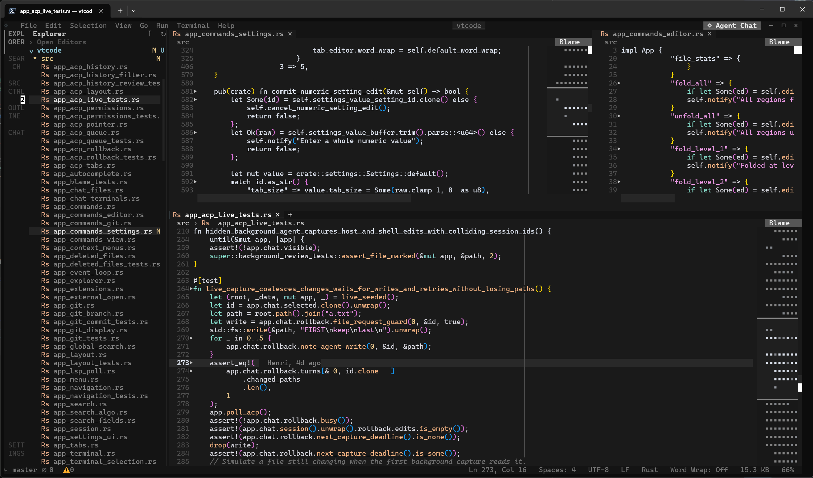
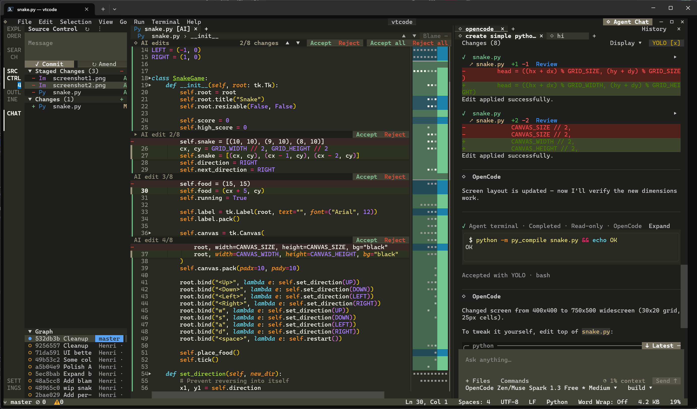
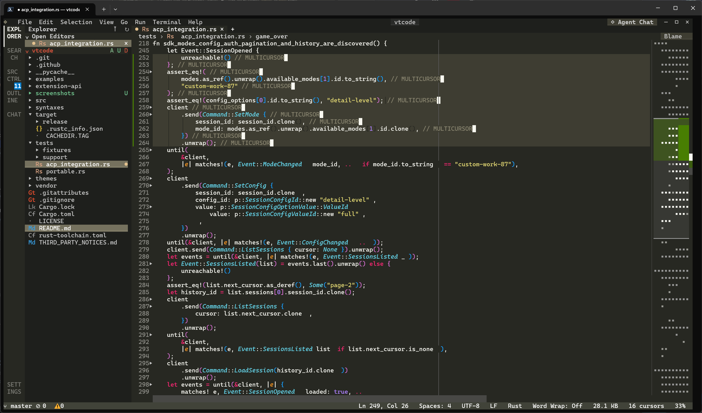
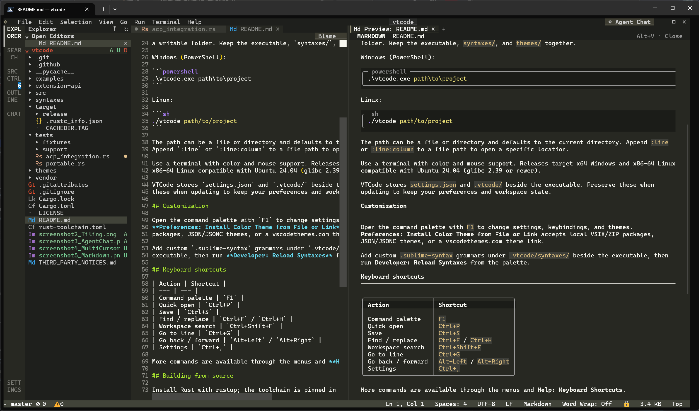
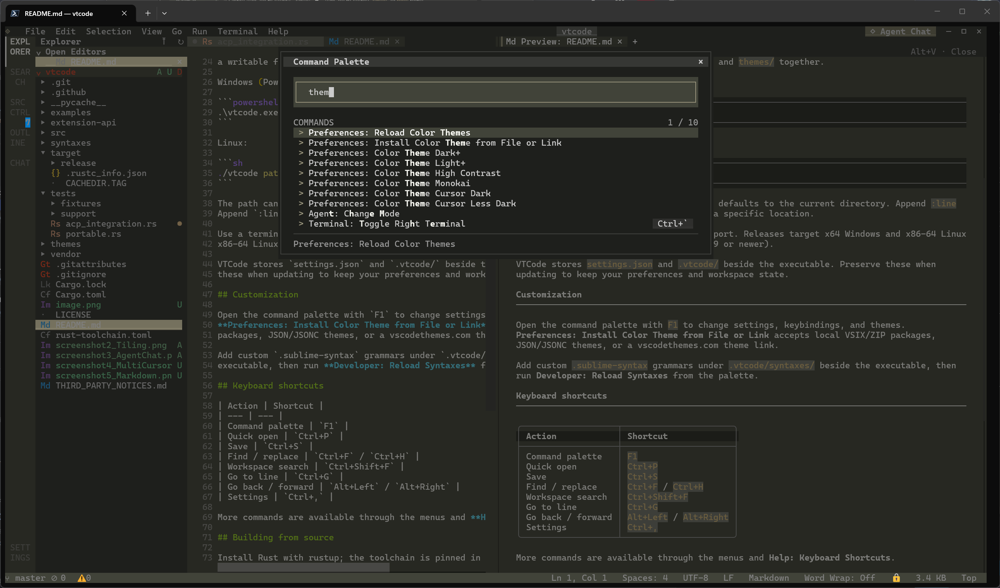
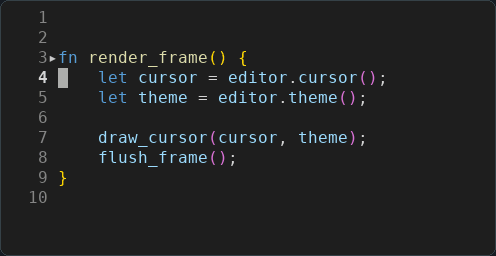
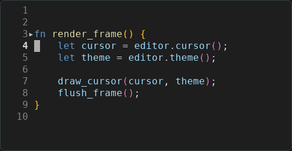
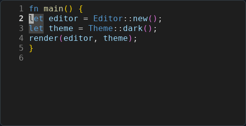
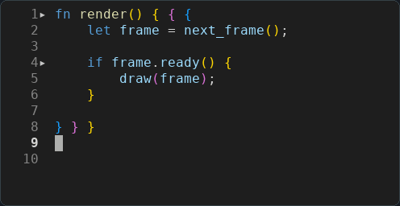
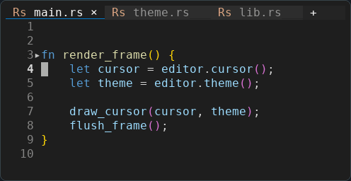

# VTCode

**A code editor for your terminal, inspired by VS Code.**

Built in Rust for Windows and Linux. Under active development.

[Download](https://github.com/im-henri/vtcode/releases) · [Getting started](#getting-started) · [Animations](#animations)



## Features

- **Edit:** desks and collapsible tab groups, split panes, multiple cursors, snippets, folding, minimaps, bracket colors, sticky scroll, and keyboard macros.
- **Open folders and saved workspaces:** keep several folders open in one instance, each with its own desks, files, terminals, and Agent Chat. Switch from the directory title and save folder collections as named workspaces. Background jobs keep running, with unread activity badges for completed commands, agent replies, and permission requests. Works locally and over a headless SSH connection.
- **Remote Explorer:** save named SSH targets in the **Remote** sidebar, search and connect to them, and switch between local and remote folders. Saved targets also open with `vtcode --remote-target NAME`.
- **Find and navigate:** quick file/symbol search, back/forward history, and find/replace across files. Explorer's **Find by Name…** filters filenames with substring, fuzzy, or regex matching; **Find in Folder…** searches file contents.
- **Delete files:** larger deletions show preparation, item counts, and a **Cancel** button while the editor stays usable. **File: Cancel Deletion** is also available in the Command Palette. Cancellation stops remaining items; it does not restore items already deleted.
- **VTComplete:** built-in suggestions learned from your code, with no language server required.
- **LSP features:** completion with documentation, hover, signature help, diagnostics, definitions, references, rename, code actions, inlay hints, and call/type hierarchies, depending on the language server.
- **Format:** choose LSP or an external command per language, with format-on-save support.
- **Git:** stage, unstage, or discard multiple files; commit, branch, stash, fetch, pull, and push. Source Control's **Show untracked files** choice is saved immediately as a User preference, follows an existing Workspace override, and also updates the change-count badge and Explorer decorations. Configure either scope in **Settings → Source Control → Show Untracked Files**. Review inline or side-by-side diffs, blame, and commit history; hover inline blame for commit details and the full message. **Disable** in Source Control pauses Git integration for the workspace; **Settings → Source Control → Enable Source Control** also supports a User-wide default.
- **Repositories:** nested Git projects appear separately in Source Control, with independent changes and commit messages. Repositories above the opened folder require **Open Repository** before their changes are included. Click a repository header to select or collapse it, use **×** to close it, and **Actions → Open Repository…** to reopen a project. Repository visibility is remembered per workspace.
- **Terminals and previews:** multiple terminals; Markdown preview with tables, math, Mermaid diagrams, and Ctrl+Click links.
- **Agent chat:** connect Agent Client Protocol (ACP) agents, resume conversations, review changes, and respond to permission requests inside the editor.
- **Customize:** user/workspace settings, keybindings, VS Code color themes, optional animations, and [Wasm extensions](extension-api/README.md) for commands, views, and custom editors.

Filesystem-driven Git updates wait for 600 ms of quiet, with updates about every two seconds during sustained builds. Batches containing only ignored files or hidden untracked files skip worktree status scans. Open files reload promptly, and saves, Git actions, and manual refreshes bypass this delay.

## Screenshots

<table>
  <tr>
    <td align="center">
      <strong>Agent Chat</strong><br>
      <a href="screenshots/agent_chat_ACP.png"></a>
    </td>
    <td align="center">
      <strong>Multiple Cursors</strong><br>
      <a href="screenshots/multicursor.png"></a>
    </td>
  </tr>
  <tr>
    <td align="center">
      <strong>Markdown Preview</strong><br>
      <a href="screenshots/markdown_preview.png"></a>
    </td>
    <td align="center">
      <strong>Command Palette</strong><br>
      <a href="screenshots/command_palette.png"></a>
    </td>
  </tr>
</table>

## Getting started

[Download a release](https://github.com/im-henri/vtcode/releases), extract it into a writable folder, and run:

**Windows**

```powershell
.\vtcode.exe path\to\project
```

**Linux**

```sh
./vtcode path/to/project
```

Run `vtcode --help` (or `.\vtcode.exe --help` on Windows) to list all command-line
arguments and examples without opening the editor. Invalid arguments print an
error and exit without opening the editor. Use `--` before a path starting with
`-`, for example `vtcode -- -notes.txt`.

**Linux:** x86_64 builds require glibc 2.28+ or 2.43+, matching the archive name.
Check with `getconf GNU_LIBC_VERSION`; stock Alpine/musl needs a different build.

Keep `settings.json` and `.vtcode/` beside the executable when updating.

| Default shortcut | Action |
| --- | --- |
| `F1` | Command palette |
| `Ctrl+P` | Open a file by name |
| `Ctrl+,` | Settings |
| `Ctrl+F` / `Ctrl+H` | Find / replace in the editor |
| `Ctrl+Backspace` / `Ctrl+Delete` | Delete the previous / next word |
| `Alt+Left` / `Alt+Right` | Navigate back / forward |
| `Ctrl+Space` | Request suggestions; toggle LSP documentation |
| `F12` / `Shift+F12` | Definition / references |
| `Shift+Alt+F` | Format document |
| `Ctrl+Shift+G` | Source Control |
| `Ctrl+Shift+I` | Agent Chat |
| `Ctrl+Alt+PageUp` / `Ctrl+Alt+PageDown` | Previous / next folder |

Running `vtcode` without a path opens an empty editor with no folder attached.
It does not load the launch directory's settings or session, scan its Git
repository, or start its file watcher and project index. Use `vtcode .` to open
the current directory explicitly, or choose **Open folder…** in the empty window.
Loose files and tools can remain open while folders are added; their window state
is stored separately from folder sessions.

Click the directory name at the top and use **Open folders** to switch folders,
or the adjacent **+** to add a folder. **File → Open Folder…** also adds a folder
and selects it; adding an already open folder returns to its live session. Each folder keeps
its unsaved documents, undo history, desks, splits, searches, Git state, terminals,
and agent conversations while another folder is selected. User settings are
shared, and each folder keeps its own Folder settings overrides.

Inactive folders defer completion indexing, Git refreshes, searches, and editor UI
work. Switching back reuses cached state and processes pending changes. Terminals, agents, pending
saves, and background extension tasks keep running locally and over headless SSH.

A badge beside the title counts unread activity from other folders. Open the
picker to see each folder's latest event and whether it is working or needs
attention. Visiting a folder clears its folder badge; terminal and chat
views retain their own unread indicators until viewed. Terminal command completion
uses shell integration (OSC 133/633); terminal process exits are also reported.

Use **Folders: Close Current Folder…** in the Command Palette or **Close current
folder…** in the directory picker to close a folder. This action appears only when
more than one folder is open. Closing preserves unsaved edits for reopening and stops
that folder's terminals and agents. Quitting applies Save, Discard, or Keep
Unsaved to all open folders. Live processes are retained while switching
within the running instance; closing the application ends them. Over SSH, added
folders are on the same remote host and use the existing headless connection.
Update the local and headless binaries together; multi-folder watcher cleanup
uses SSH protocol 28. Use Quit to exit VTCode when only one folder is open.

**Saved workspaces:** a workspace is a named collection of one or more folders.
Choose **Save workspace…** in the directory picker to save the open folders.
Use the **Saved workspaces** tab to inspect a workspace, with each folder on its
own line, then choose **Open workspace**. Opening switches to exactly those folders
and restores the starting folder. Matching open folders keep their files, undo, terminals, and chat.
Before other folders close, a confirmation lists them; unsaved edits are
preserved for next time and their terminals and agents stop. Missing folders
leave the current folders open. Each folder restores its latest saved session.
Use **Update from open folders…**, **Rename workspace…**, and **Delete workspace…**
to manage saved workspaces. They persist in the portable `.vtcode/workspace-sets.json`;
remote workspaces belong to the current SSH
connection and can be reopened after connecting with the same launch command.

Reopening a closed file during the same workspace session restores its cursor
and scroll position, including when opening it from the explorer or file picker.

File search and workspace search each remember their last 50 queries per
workspace, including after restarting VTCode. Workspace search also keeps separate
histories for replacement text and the include/exclude paths. Use **↑/↓** in the
Find field or any workspace search field to recall history; **Alt+↑/↓** navigates
workspace search results.

In-file Find and workspace search remember separate Match Case, Whole Word,
Regular Expression, and Preserve Case options. Search shortcuts apply to the
focused search view; the two sets of preferences are also available in Settings.
Each file tab keeps its own Find/Replace fields, matches, and widget width.
Split editors display their Find bars inside their respective panes.
While a workspace search is running, click **■** in the Search header or press
**Escape** with search focused to stop searching and keep the results found so far.
Click **↻** to run the search again.

Workspace search waits 300 ms after typing by default. Change **Search: Debounce
(ms)** in **Settings → Features → Search**, or set
`search.searchOnTypeDebouncePeriod` in JSON. A value of `0` searches immediately.
Enter or **↻** runs a pending search immediately. Per-file Find remains instant.

Configure **Files: Exclude** in **Settings → Files → Exclusions** and
**Search: Exclude** in **Settings → Features → Search**. Both accept glob patterns
in User or Workspace scope. `files.exclude` hides paths in Explorer;
`search.exclude` applies to workspace text search and Quick Open and inherits
every `files.exclude` pattern without listing those inherited patterns in its
control. A `false` entry disables the same inherited or default pattern.

The file defaults are `**/.git`, `**/.svn`, `**/.hg`, `**/.jj`, `**/.DS_Store`,
and `**/Thumbs.db`. Search additionally excludes `**/node_modules`,
`**/bower_components`, and `**/*.code-search`. Settings globs are relative to the
workspace root; sibling conditions such as `{ "when": "$(basename).ts" }` are
supported. To filter Quick Open's recent-file history, use a pattern matching
the absolute path, such as `**/node_modules/**`.

Build output and other hidden files remain searchable unless an explicit pattern
excludes them. `.gitignore`, `.ignore`, parent ignore files, and global Git ignore
rules never filter these searches. The search view's include and exclude fields
further narrow the results. Local and remote SSH workspaces use the same rules.

Some terminals send the same byte for `Ctrl+H` and `Ctrl+Backspace`. VTCode
prioritizes deletion when they cannot be distinguished; use **Edit → Replace**
or the command palette instead. Extended key reporting keeps both shortcuts distinct.

Rename terminal tabs by right-clicking a tab and choosing **Rename Terminal…**,
or use **Terminal → Rename Terminal…** or the command palette. Names stay with
the session when moving between the side panel and an editor tab.

In **Source Control → Actions**, choose **Rebase Current Branch…** or
**Cherry-pick Commit…** to start an operation. Enter the base branch or commit;
cherry-picking also uses the selected Graph commit when the Graph is open.
Operations started in the terminal appear in Source Control too, including over
SSH. Resolve each conflict, save the file, and stage its resolution. The operation
card explains any remaining blockers and enables **Continue Rebase** or
**Continue Cherry-pick** when the repository is ready. **Skip Commit…** and
**Abort…** ask for confirmation before discarding resolution changes.

In terminal output, right-click a selection to copy it and clear the selection;
right-click without a selection to paste. Mouse-aware terminal applications receive
their own mouse events; hold **Shift** to use local selection and clipboard actions.

**View → Auto-hide Sidebar** hides the sidebar until you move the pointer to
its edge or the Activity Bar. It stays open while you use sidebar fields or menus.
This is off by default and can also be changed in **Settings → Workbench → Layout**
with **Auto-hide Sidebar** (`sidebarAutoHide` in `settings.json`).

**File Associations** also updates file icons throughout the Explorer, editor tabs,
breadcrumbs, Quick Open, and Source Control. Explicit associations override built-in
file types; for example, associating `*.rs` with C++ uses the C++ language and icon.

Large files are sampled for binary data before text loading. In SSH mode these
checks run on the remote node, which returns the binary-file notice when detected.
Binary editor extensions, such as Hex Viewer, remain available through **Open With**.

**Using VTCode over SSH?** For editing that stays local and responsive over a
slow connection, launch
`vtcode.exe --remote user@host`. To choose a folder or use a scheduler, add
`--remote-command 'submitcmd vtcode --headless /path/to/project'` (omit `submitcmd`
for a direct connection). `--ssh-command 'ssh -e none -tt -vv'` overrides the SSH
executable and flags. No second terminal is needed; the job's input/output stays
attached to this SSH connection.

Open **Remote** in the left activity bar (or run **View: Open Remote** from `F1`)
to manage saved targets. Choose **+ Add**, enter a name and SSH host or config
alias, and optionally enter a remote folder. **Save & Connect** opens it;
**Save** keeps it for later. SSH authentication appears inside VTCode. Both
machines need matching VTCode builds, with `vtcode` on the remote host's PATH
unless you supply a custom command.

Targets open as live workspaces. Your previous folder, open buffers and tools
remain available through the directory title's workspace switcher. Connecting
to an already open target switches to that workspace. The current connection
appears above the target list; **Save Target** also saves a connection opened
using `--remote`.
Use **Close** in that section to close the remote workspace. When no other
workspace is open, VTCode returns to a local editor window.

Search by name, host or folder. Press `Enter` to connect, `F2` to edit, `N` to
add, `Delete` to remove, and `F5` to refresh. Right-click a target or choose
**⋯** for Connect, Edit, Duplicate and Remove. Removing a saved target keeps
its open workspaces connected. Forms support `Tab` / `Shift+Tab`, clipboard
editing, `Ctrl+S` to save, and `Esc` to cancel.

SSH sign-in opens in a full editor tab. Type at the prompt, then press `Enter`;
SSH deliberately hides password and passphrase characters. `Ctrl+V` pastes
into the prompt. Switch tabs to keep working while it connects, or close the
sign-in tab to cancel. Reconnect sign-in also uses an editor tab.

**Advanced connection options** accepts the same remote and SSH commands as
the command line. A custom remote command replaces the default command and
the Folder field; include the folder in that command, for example
`submitcmd vtcode --headless /path/to/project`. The SSH command is the local
executable and flags, such as `ssh -e none -tt -p 2222`. SSH keys, config and
the SSH agent work as usual.

Targets are saved in `.vtcode/remote-targets.json` beside the local executable,
shared by all of its workspaces. Keep this file when moving or updating VTCode.
Manual edits take effect after **Refresh**. Invalid files show an error while
keeping the last loaded targets visible. Changes to different targets merge;
if the same target changes elsewhere, reload it or save your draft as a copy.

```sh
vtcode --remote-target development
vtcode --remote-target "My server"
```

The flag uses the saved target as configured. Use `--remote HOST` for an ad hoc
connection with `--remote-command` or `--ssh-command` overrides.
Use `F1` for the command palette if its other shortcut is intercepted.

Over SSH, copying reaches your local clipboard through OSC 52 when your terminal
allows it, including VTCode's built-in terminal. Use your terminal's **Paste**
shortcut for text copied in other applications; VTCode also remembers copied and
pasted text across editor tabs without needing a remote desktop clipboard.

## VTComplete

VTComplete is the built-in completion engine, separate from LSP suggestions.
It learns identifiers and calling patterns from your code without a language
server. Its popup is labeled **VTComplete**; language-server results are labeled
**LSP suggestions**. **Tab** inserts a suggestion, **↑/↓** selects another, and
**Esc** dismisses the popup. **Ctrl+Space** requests suggestions explicitly.

Click **VTComplete** in the status bar or run **VTComplete: Manage File Learning**
to manage learned files and resource limits. **Files you open** is the default;
**Entire workspace** opts into gradual, ignore-aware discovery for local projects.
**Pause learning** keeps learned suggestions available. **File learning CPU**
controls learning and cache loading, not prediction. Background work sleeps when idle.

Preferences live under **Settings → Text Editor → VTComplete**. The shared toggle
for automatic VTComplete and LSP popups is under **Text Editor → Suggestions**.
Automatic VTComplete suggestions start with one character and useful code
punctuation; these triggers are configurable. The default source-file limit is
**100 MiB**, adjustable up to **1 GiB**.

Saved-file learning persists between sessions for local and remote workspaces.
Remote learning uses already loaded files, adds no SSH source reads, and never
scans unopened files.

## Language servers

Install a language server separately, then open **Settings → Language Servers →
Manage Servers** or click **LSP** in the status bar. Add its language ID,
executable, file patterns, and arguments. Choose **User** or **Workspace** settings;
the workspace server list overrides the user list.

Use Pyright for Python, clangd for C/C++, or another server supporting LSP over
stdin/stdout. Diagnostics wait for a pause in typing;
adjust **Diagnostic Delay (ms)** in Language Servers settings.

**Formatting is independent of LSP.** The first format request asks for a formatter
per language and remembers the choice. Use **External Command** for tools such as
Black, or **Language Server** for servers such as clangd. External tools must be installed
separately. Change the choice through **Configure Formatter…** in the command
palette or **Settings → Files → Formatters → Configure…**.
External commands can edit a temporary file or return formatted text on stdout.
File mode starts with `{file}` as an argument, includes unsaved edits, and applies
formatting as one undoable change; it writes the original file only on Save.

## Customization and tools

Open **File → Settings…** for preferences or **File → Keyboard Shortcuts…** to
edit bindings. **Help → Keyboard Shortcut Reference** shows the quick reference.
**View** groups workspace views, panels, editor splits, and common display options;
additional appearance controls are in Settings and the command palette.
Syntax installation and reload are available through **Preferences: Install Syntax
from File** and **Developer: Reload Syntaxes** in the command palette.

- **Settings:** use **User** for defaults and **Workspace** for project overrides; edit through the UI or JSON.
- **File types:** click the status bar language → **Configure File Associations…**, or open **Settings → Files → File Associations**. Map extensions (`*.h`) or filenames (`Jenkinsfile`) to a language globally or per workspace; edit or remove rules in the same dialog. Applies to highlighting, LSP, and formatter selection.
- **Content detection:** files without a recognized name or extension are classified in the background by [Magika](https://github.com/google/magika), using its embedded model and confidence thresholds. Only bounded samples of the open buffer's beginning and end are inspected, including for remote files; detection makes no disk or network requests. Manual language choices and file associations take precedence, and uncertain content stays plain text.
- **Themes:** choose from 29 built-in palettes in **Settings → Workbench → Appearance → Color Theme**, including One Dark Pro, Dracula, GitHub Dark, Tokyo Night, Catppuccin, Nord, Night Owl, Ayu, Rosé Pine, and Gruvbox. All built-ins work offline; see the [full catalog and sources](themes/SOURCE.md). To add more, run **Preferences: Install Color Theme from File or Link** and paste a [VS Code Themes](https://vscodethemes.com/) link or a local `.vsix` path. Use **Delete…** beside an installed variant (or the Delete key) and confirm to remove it. Bundled themes are protected. Removals persist; reinstalling a pack restores its removed variants.
- **Syntaxes:** run **Preferences: Install Syntax from File** with a local TextMate `.tmLanguage.json` or `.tmLanguage` file. Highlighting reloads automatically; URLs are not accepted. All languages use the same native TextMate tokenizer and VS Code theme rules. Grammar sources live in the root [grammars](grammars/README.md) directory: `grammars/bundled` is compiled into the executable, and the Rust, Python, and Git folders hold the VS Code overrides. Portable releases ship these assets in `grammars/` beside the executable.
- **Agents:** install an ACP-compatible agent separately, then run **Agent: Configure Agents** from the command palette.
- **Extensions:** install through **Extensions: Install Extension from GitHub**. See the [Wasm extension guide](extension-api/README.md) to build your own.
- **Performance & activity:** pin the live monitor while you work: CPU/memory trends, UI responsiveness, slow calls, worker queues, task timings, and workspace details. Resource sampling runs at most every 10 seconds while visible and the app is focused.

## Animations

**Sliding Tabs** is enabled by default with a **250 ms** duration. Other effects
are off by default; configure them in **Settings → Animations**.
**Sliding Tabs** animates reordered tabs and their displaced neighbors, as well
as the active underline when switching tabs. Repeated reorders continue from
the current motion, and the duration and intensity controls apply to both.
Cursor Smear, Fire Hazard, Whitespace Reveal, and Scope Bubble pause during
multicursor editing. **Scope Bubble: Background Fill** adds animated shading
after the scope outline finishes drawing.
**Scope Bubble: Language Rules** lets you choose a parsing style and delimiter
pairs (`{}`, `()`, `[]`) per language, with User and Workspace overrides.
For example, use C++ scopes for a custom syntax or add parentheses to C++.
Cosmetic redraws adapt to rendering speed on slower computers, leaving time
for input; the configured FPS remains the upper limit.

<table>
  <tr>
    <td align="center">
      <strong>Cursor Smear</strong><br>
      
    </td>
    <td align="center">
      <strong>Fire Hazard</strong><br>
      
    </td>
  </tr>
  <tr>
    <td align="center">
      <strong>Whitespace Reveal</strong><br>
      
    </td>
    <td align="center">
      <strong>Scope Bubble</strong><br>
      
    </td>
  </tr>
  <tr>
    <td colspan="2" align="center">
      <strong>Sliding Tabs</strong><br>
      
    </td>
  </tr>
</table>

## Build from source

```sh
cargo run --locked --release -- path/to/project
```

For faster development builds with incremental compilation:

```sh
cargo run --locked --profile fastrelease -- path/to/project
```

To build portable packages of the current checkout, use
`scripts/build.ps1 --target all` on Windows, or
`sh scripts/build.sh --target linux --glibc both` on Linux. Use `--output-dir PATH`
to choose the destination and `--glibc 2.28` or `--glibc 2.43` for just one Linux variant.
Add `--skip-tests` to compile and package without running tests or installing test dependencies.

## License

[MIT](LICENSE) · [Third-party notices](THIRD_PARTY_NOTICES.md)
