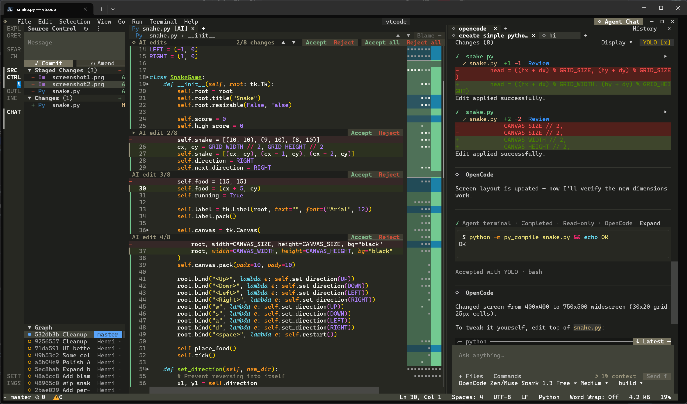
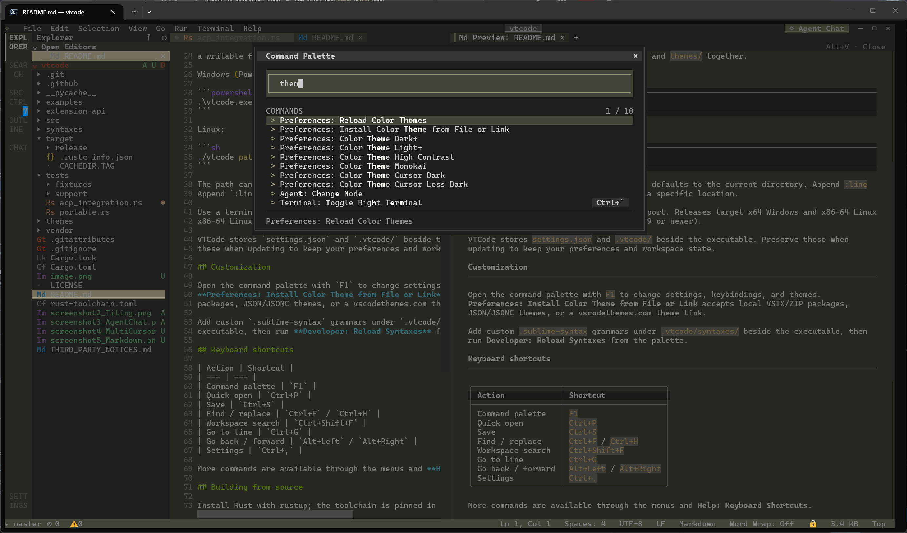
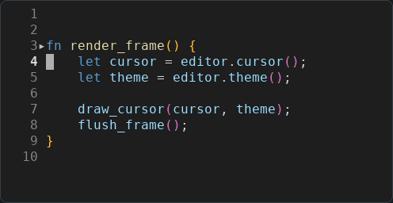
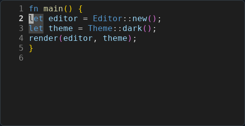
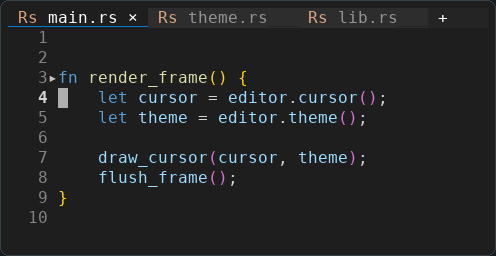

# VTCode

**A code editor for your terminal, inspired by VS Code.**

Built in Rust for Windows and Linux. Under active development.

[Download](https://github.com/im-henri/vtcode/releases) · [Getting started](#getting-started) · [Animations](#animations)


## Features

- **Edit:** desks and collapsible tab groups, split panes, multiple cursors, snippets, folding, minimaps, bracket colors, sticky scroll, and keyboard macros.
- **Open folders and saved workspaces:** keep several folders open in one instance, each with its own desks, files, terminals, and Agent Chat. Switch from the directory title and save folder collections as named workspaces. Background jobs keep running, with unread activity badges for completed commands, agent replies, and permission requests. Works locally and over a headless SSH connection.
- **Remote Explorer:** save named SSH targets in the **Remote** sidebar, search and connect to them, and switch between local and remote folders. Saved targets also open with `vtcode --remote-target NAME`.
- **Find and navigate:** quick file/symbol search, back/forward history, and find/replace across files. Explorer's **Find by Name…** filters filenames with substring, fuzzy, or regex matching. Right-click a folder to search only that folder and its descendants (or a file to search its containing folder). Edit the **In:** path (Alt+P) and press Enter to change folders; relative and absolute paths are supported. Clear the path or use **Workspace** (Alt+W) to search the workspace. **Find in Folder…** searches file contents.
- **Delete files:** larger deletions show preparation, item counts, and a **Cancel** button while the editor stays usable. **File: Cancel Deletion** is also available in the Command Palette. Cancellation stops remaining items; it does not restore items already deleted.
- **Autocomplete:** VTComplete suggests words from the active file. GPTComplete predicts inline continuations with a built-in language model.
- **LSP features:** completion with documentation, hover, signature help, diagnostics, definitions, references, rename, code actions, inlay hints, and call/type hierarchies, depending on the language server.
- **Format:** choose LSP or an external command per language, with format-on-save support.
- **Git:** stage, unstage, or discard multiple files; commit, branch, stash, fetch, pull, and push. Source Control's **Show untracked files** choice is saved immediately as a User preference, follows an existing Workspace override, and also updates the change-count badge and Explorer decorations. Configure either scope in **Settings → Source Control → Show Untracked Files**. Review inline or side-by-side diffs, blame, and commit history; hover inline blame for commit details and the full message. **Disable** in Source Control pauses Git integration for the workspace; **Settings → Source Control → Enable Source Control** also supports a User-wide default.
- **Repositories:** nested Git projects appear separately in Source Control, with independent changes and commit messages. Repositories above the opened folder require **Open Repository** before their changes are included. Click a repository header to select or collapse it, use **×** to close it, and **Actions → Open Repository…** to reopen a project. Repository visibility is remembered per workspace.
- **Terminals and previews:** multiple terminals; Markdown preview with tables, math, Mermaid diagrams, and Ctrl+Click links.
- **Agent chat:** connect Agent Client Protocol (ACP) agents, resume conversations, review changes, and respond to permission requests inside the editor.
- **Customize:** user/workspace settings, keybindings, VS Code color themes, optional animations, and [Wasm extensions](extension-api/README.md) for commands, views, and custom editors.

Filesystem-driven Git updates wait for 600 ms of quiet, with updates about every two seconds during sustained builds. Batches containing only ignored files or hidden untracked files skip worktree status scans. Open files reload promptly, and saves, Git actions, and manual refreshes bypass this delay.

Large-repository status refreshes automatically use the installed Git executable for faster scans, with bundled libgit2 as a fallback when Git is unavailable. Startup shows the repository and current branch first, then its changes while remaining repositories are discovered, including over SSH. Remote status scans use a separate queue so discovery cannot hold up staging or diff requests.

Navigating back to Source Control reuses watched status, with complete revalidation after 30 seconds. Index-only changes update staged files without reloading commit history or branch counts. Repository discovery caches inherited ignore rules using Explorer's matcher and reuses directory listings to avoid redundant Git metadata probes.

## Screenshots

<table>
  <tr>
    <td align="center">
      <strong>Agent Chat</strong><br>
      <a href="screenshots/agent_chat_ACP.png"></a>
    </td>
    <td align="center">
      <strong>Multiple Cursors</strong><br>
      <a href="screenshots/multicursor.png"></a>
    </td>
  </tr>
  <tr>
    <td align="center">
      <strong>Markdown Preview</strong><br>
      <a href="screenshots/markdown_preview.png"></a>
    </td>
    <td align="center">
      <strong>Command Palette</strong><br>
      <a href="screenshots/command_palette.png"></a>
    </td>
  </tr>
</table>

## Getting started

[Download a release](https://github.com/im-henri/vtcode/releases), extract it into a writable folder, and run:

**Windows**

```powershell
.\vtcode.exe path\to\project
```

**Linux**

```sh
./vtcode path/to/project
```

Run `vtcode --help` (or `.\vtcode.exe --help` on Windows) to list all command-line
arguments and examples without opening the editor. Invalid arguments print an
error and exit without opening the editor. Use `--` before a path starting with
`-`, for example `vtcode -- -notes.txt`.

**Linux:** x86_64 builds require glibc 2.28+ or 2.43+, matching the archive name.
Check with `getconf GNU_LIBC_VERSION`; stock Alpine/musl needs a different build.

Keep `settings.json` and `.vtcode/` beside the executable when updating.

| Default shortcut | Action |
| --- | --- |
| `F1` | Command palette |
| `Ctrl+P` | Open a file by name |
| `Ctrl+,` | Settings |
| `Ctrl+F` / `Ctrl+H` | Find / replace in the editor |
| `Ctrl+Backspace` / `Ctrl+Delete` | Delete the previous / next word |
| `Alt+Left` / `Alt+Right` | Navigate back / forward |
| `Ctrl+Space` | Request suggestions; toggle LSP documentation |
| `F12` / `Shift+F12` | Definition / references |
| `Shift+Alt+F` | Format document |
| `Ctrl+Shift+G` | Source Control |
| `Ctrl+Shift+I` | Agent Chat |
| `Ctrl+Alt+PageUp` / `Ctrl+Alt+PageDown` | Previous / next folder |

Running `vtcode` without a path opens an empty editor with no folder attached.
It does not load the launch directory's settings or session, scan its Git
repository, or start its file watcher. Use `vtcode .` to open
the current directory explicitly, or choose **Open folder…** in the empty window.
Loose files and tools can remain open while folders are added; their window state
is stored separately from folder sessions.

Use **File → Open File…** (also available in the command palette) to browse for
an individual file anywhere. You can also enter an absolute path, a path
relative to the folder shown in the browser, or a `file://` URL. In a headless SSH
session, the browser starts on **Remote**. Choose **Use This Device** to browse
local files. Save writes back to the original file on the device it came from.

Click the directory name at the top and use **Open folders** to switch folders,
or the adjacent **+** to add a folder. **File → Open Folder…** also adds a folder
and selects it; adding an already open folder returns to its live session. Each folder keeps
its unsaved documents, undo history, desks, splits, searches, Git state, terminals,
and agent conversations while another folder is selected. User settings are
shared, and each folder keeps its own Folder settings overrides.

Inactive folders defer Git refreshes, searches, and editor UI
work. Switching back reuses cached state and processes pending changes. Terminals, agents, pending
saves, and background extension tasks keep running locally and over headless SSH.

A badge beside the title counts unread activity from other folders. Open the
picker to see each folder's latest event and whether it is working or needs
attention. Visiting a folder clears its folder badge; terminal and chat
views retain their own unread indicators until viewed. Terminal command completion
uses shell integration (OSC 133/633); terminal process exits are also reported.

When remote terminal input waits more than 200 ms for acknowledgement, the tab
shows a spinner and the cursor becomes the same spinner. Hover over the tab for
an explanation. Both spinners clear on acknowledgement, including at silent
password prompts.

Use **Folders: Close Current Folder…** in the Command Palette or **Close current
folder…** in the directory picker to close a folder. This action appears only when
more than one folder is open. Closing preserves unsaved edits for reopening and stops
that folder's terminals and agents. Quitting applies Save, Discard, or Keep
Unsaved to all open folders. Live processes are retained while switching
within the running instance; closing the application ends them. Over SSH, added
folders are on the same remote host and use the existing headless connection.
Update the local and headless binaries together; multi-folder watcher cleanup
uses SSH protocol 28. Use Quit to exit VTCode when only one folder is open.

**Saved workspaces:** a workspace is a named collection of one or more folders.
Choose **Save workspace…** in the directory picker to save the open folders.
Use the **Saved workspaces** tab to inspect a workspace, with each folder on its
own line, then choose **Open workspace**. Opening switches to exactly those folders
and restores the starting folder. Matching open folders keep their files, undo, terminals, and chat.
Before other folders close, a confirmation lists them; unsaved edits are
preserved for next time and their terminals and agents stop. Missing folders
leave the current folders open. Each folder restores its latest saved session.
Use **Update from open folders…**, **Rename workspace…**, and **Delete workspace…**
to manage saved workspaces. They persist in the portable `.vtcode/workspace-sets.json`;
remote workspaces belong to the current SSH
connection and can be reopened after connecting with the same launch command.

Reopening a closed file during the same workspace session restores its cursor
and scroll position, including when opening it from the explorer or file picker.

File search and workspace search each remember their last 50 queries per
workspace, including after restarting VTCode. Workspace search also keeps separate
histories for replacement text and the include/exclude paths. Use **↑/↓** in the
Find field or any workspace search field to recall history; **Alt+↑/↓** navigates
workspace search results.

In-file Find and workspace search remember separate Match Case, Whole Word,
Regular Expression, and Preserve Case options. Search shortcuts apply to the
focused search view; the two sets of preferences are also available in Settings.
Each file tab keeps its own Find/Replace fields, matches, and widget width.
Split editors display their Find bars inside their respective panes.
While a workspace search is running, click **■** in the Search header or press
**Escape** with search focused to stop searching and keep the results found so far.
Click **↻** to run the search again.

Workspace search waits 300 ms after typing by default. Change **Search: Debounce
(ms)** in **Settings → Features → Search**, or set
`search.searchOnTypeDebouncePeriod` in JSON. A value of `0` searches immediately.
Enter or **↻** runs a pending search immediately. Per-file Find remains instant.

Configure **Files: Exclude** in **Settings → Files → Exclusions** and
**Search: Exclude** in **Settings → Features → Search**. Both accept glob patterns
in User or Workspace scope. `files.exclude` hides paths in Explorer;
`search.exclude` applies to workspace text search and Quick Open and inherits
every `files.exclude` pattern without listing those inherited patterns in its
control. A `false` entry disables the same inherited or default pattern.

The file defaults are `**/.git`, `**/.svn`, `**/.hg`, `**/.jj`, `**/.DS_Store`,
and `**/Thumbs.db`. Search additionally excludes `**/node_modules`,
`**/bower_components`, and `**/*.code-search`. Settings globs are relative to the
workspace root; sibling conditions such as `{ "when": "$(basename).ts" }` are
supported. To filter Quick Open's recent-file history, use a pattern matching
the absolute path, such as `**/node_modules/**`.

Build output and other hidden files remain searchable unless an explicit pattern
excludes them. `.gitignore`, `.ignore`, parent ignore files, and global Git ignore
rules never filter these searches. The search view's include and exclude fields
further narrow the results. Local and remote SSH workspaces use the same rules.

Some terminals send the same byte for `Ctrl+H` and `Ctrl+Backspace`. VTCode
prioritizes deletion when they cannot be distinguished; use **Edit → Replace**
or the command palette instead. Extended key reporting keeps both shortcuts distinct.

Each unpinned editor tab has a visible **×** close button beside its label.

Rename terminal tabs by right-clicking a tab and choosing **Rename Terminal…**,
or use **Terminal → Rename Terminal…** or the command palette. Names stay with
the session when moving between the side panel and an editor tab.

In **Source Control → Actions**, choose **Rebase Current Branch…** or
**Cherry-pick Commit…** to start an operation. Enter the base branch or commit;
cherry-picking also uses the selected Graph commit when the Graph is open.
Operations started in the terminal appear in Source Control too, including over
SSH. Resolve each conflict, save the file, and stage its resolution. The operation
card explains any remaining blockers and enables **Continue Rebase** or
**Continue Cherry-pick** when the repository is ready. **Skip Commit…** and
**Abort…** ask for confirmation before discarding resolution changes.

Click a colored gutter marker to preview a change. The copy icon beside each
block's **+ / −** controls copies its old lines. Right-click the preview for
copy, select-all, and change actions, including copying a single old line.
**Shift+F10** opens this menu from the keyboard; **Esc** dismisses the menu first.

In terminal output, right-click a selection to copy it and clear the selection;
right-click without a selection to paste. Mouse-aware terminal applications receive
their own mouse events; hold **Shift** to use local selection and clipboard actions.

Hold **Ctrl** over a file path in terminal output to underline it, then
**Ctrl+click** to open the file. Compiler locations such as `src/main.c:12:7`
and `"src/main.c", line 12, column 7` also jump to the reported line and column.
This works in local and SSH terminals. Relative paths follow directory changes
reported by Bash, Zsh, Fish, and PowerShell shell integration.

Use **Ctrl+click** on paths in plain text, log, and Markdown source tabs too.
Relative paths start from the open file's folder. Bare relative paths also try
the workspace root when the target is missing. Line and column references work
in editor tabs as they do in the terminal.

**Ctrl+click** the path in a C or C++ include to open the header in local and SSH
workspaces. Quoted includes look in the current file's folder first. Angle-bracket
includes look in the workspace's `include/` directory and root first. Literal file
references in Rust, JavaScript, TypeScript, shell scripts, and CMake work the same
way, without requiring a language server.

**View → Auto-hide Sidebar** hides the sidebar until you move the pointer to
its edge or the vertical Activity Bar in Left mode. It stays open while you use
sidebar fields or menus.
This is off by default and can also be changed in **Settings → Workbench → Layout**
with **Auto-hide Sidebar** (`sidebarAutoHide` in `settings.json`).

The Activity Bar uses compact icons in the sidebar header by default, freeing
six columns for the workbench while keeping the editor tabs directly below the
menu. Hover an icon to see its name. Switch with **View → Move Activity Bar to
Left** or use **Activity Bar Position** under **Settings → Workbench → Layout**
(`"activityBarPosition": "top"` or `"activityBarPosition": "left"` in `settings.json`).
Use **View → Sidebar** (`Ctrl+B`) to reopen a hidden sidebar.

**File Associations** also updates file icons throughout the Explorer, editor tabs,
breadcrumbs, Quick Open, and Source Control. Explicit associations override built-in
file types; for example, associating `*.rs` with C++ uses the C++ language and icon.

Large files are sampled for binary data before text loading. In SSH mode these
checks run on the remote node, which returns the binary-file notice when detected.
Binary editor extensions, such as Hex Viewer, remain available through **Open With**.

**Using VTCode over SSH?** For editing that stays local and responsive over a
slow connection, launch
`vtcode.exe --remote user@host`. To choose a folder or use a scheduler, add
`--remote-command 'submitcmd vtcode --headless /path/to/project'` (omit `submitcmd`
for a direct connection). `--ssh-command 'ssh -e none -tt -vv'` overrides the SSH
executable and flags. No second terminal is needed; the job's input/output stays
attached to this SSH connection.

Open **Remote** in the Activity Bar (or run **View: Open Remote** from `F1`)
to manage saved targets. Choose **+ Add**, enter a name and SSH host or config
alias, and optionally enter a remote folder. **Save & Connect** opens it;
**Save** keeps it for later. SSH authentication appears inside VTCode. Both
machines need matching VTCode builds, with `vtcode` on the remote host's PATH
unless you supply a custom command.

Targets open as live workspaces. Your previous folder, open buffers and tools
remain available through the directory title's workspace switcher. Connecting
to an already open target switches to that workspace. The current connection
appears above the target list; **Save Target** also saves a connection opened
using `--remote`.
Use **Close** in that section to close the remote workspace. When no other
workspace is open, VTCode returns to a local editor window.

Search by name, host or folder. Press `Enter` to connect, `F2` to edit, `N` to
add, `Delete` to remove, and `F5` to refresh. Right-click a target or choose
**⋯** for Connect, Edit, Duplicate and Remove. Removing a saved target keeps
its open workspaces connected. Forms support `Tab` / `Shift+Tab`, clipboard
editing, `Ctrl+S` to save, and `Esc` to cancel.

SSH sign-in opens in a full editor tab. Type at the prompt, then press `Enter`;
SSH deliberately hides password and passphrase characters. `Ctrl+V` pastes
into the prompt. Switch tabs to keep working while it connects, or close the
sign-in tab to cancel. Reconnect sign-in also uses an editor tab.

**Advanced connection options** accepts the same remote and SSH commands as
the command line. A custom remote command replaces the default command and
the Folder field; include the folder in that command, for example
`submitcmd vtcode --headless /path/to/project`. The SSH command is the local
executable and flags, such as `ssh -e none -tt -p 2222`. SSH keys, config and
the SSH agent work as usual.

Targets are saved in `.vtcode/remote-targets.json` beside the local executable,
shared by all of its workspaces. Keep this file when moving or updating VTCode.
Manual edits take effect after **Refresh**. Invalid files show an error while
keeping the last loaded targets visible. Changes to different targets merge;
if the same target changes elsewhere, reload it or save your draft as a copy.

```sh
vtcode --remote-target development
vtcode --remote-target "My server"
```

The flag uses the saved target as configured. Use `--remote HOST` for an ad hoc
connection with `--remote-command` or `--ssh-command` overrides.
Use `F1` for the command palette if its other shortcut is intercepted.

Over SSH, copying reaches your local clipboard through OSC 52 when your terminal
allows it, including VTCode's built-in terminal. Use your terminal's **Paste**
shortcut for text copied in other applications; VTCode also remembers copied and
pasted text across editor tabs without needing a remote desktop clipboard.

### Detached tabs

On Windows Terminal and X11 desktops, drag an editor tab outside its terminal
window to open it in a separate terminal. Drop another tab onto that window to
add it, or drag a tab onto the main window to return it. You can open as many
detached windows as your desktop can host.

Detached windows show the tab strip and editor panes. They share the same
workspace, so unsaved edits, undo history, and terminal sessions travel with
their tabs. Closing a detached terminal returns its tabs to the main window.

Right-click a tab and choose **Move to New Window** or **Move to Window…**.
Both commands are also in the Command Palette. Use these commands on Wayland
or in terminals that report mouse coordinates only within their own viewport.

## VTComplete

VTComplete provides word suggestions from the active editor buffer, including
unsaved edits, along with language keywords and snippets. It scans the buffer
when suggestions are requested. **Tab** inserts a suggestion, **↑/↓** selects
another, **Esc** dismisses the popup, and **Ctrl+Space** requests suggestions.

Under **Settings → Autocomplete**, use **VTComplete** for word suggestions and
**GPTComplete** for inline predictions. **General → Show Suggestions While Typing**
controls automatic suggestions for both, as well as language-server completion.

## GPTComplete

GPTComplete is off by default. To enable it for your workspace, click
**GPTComplete Off** in the status bar and choose **Turn On GPTComplete**, or use
**Settings → Autocomplete → GPTComplete → Inline Predictions**.

While you type, GPTComplete predicts the next several tokens — often the
rest of the line, sometimes the following lines of a block — and shows them
dimmed after the caret. **Tab** inserts the prediction, **Ctrl+Right** inserts
its next word, **Esc** hides it, and typing along it keeps the remainder.
**Alt+I** (or **GPTComplete: Predict Here** in the Command Palette) shows the
best guess at the caret, including when **Show Suggestions While Typing** is off.
The word popup returns when no prediction is shown, after **Esc**, or with **Ctrl+Space**.

Click **GPTComplete** in the status bar to set **Eagerness**, snooze for **1, 5,
or 10 minutes**, choose **Snooze Until Resumed**, or turn GPTComplete off. The
workspace remembers whether GPTComplete is on, its eagerness, and untimed snoozes
across restarts. Snoozing or turning GPTComplete off also pauses **Alt+I**.

Two predictors work together. Both run on one background CPU thread, need no
GPU and download nothing:

- **Patterns in the active file.** The predictor finds earlier places whose
  surrounding tokens match the caret, including places that differ only by
  consistently renamed identifiers (`self.left = left;` teaches
  `self.right = right;`, and `left_margin` → `right_margin` also turns
  `set_left_edge` into `set_right_edge`), and lets them vote on each next
  token.
- **A small language model.** A transformer of about 24 million weights
  (24 MB, one byte per weight) is built into the editor. It was trained on
  about 550 open-source projects in some forty languages and on prose. It
  reads and writes text in pieces smaller than words, about 16,000 of them
  learned from that code (`Layout`, `Render`, `ers`, ` self`, `.`, a line end
  with its indentation), down to single bytes. So it can write any text,
  including a name that stands nowhere yet, and it needs no rules for a
  language: comments, strings and documentation are text like everything
  else. Tokens cover more text than before, and the context is larger:

  - up to 1,024 tokens before the caret (several thousand characters);
  - the text just below the caret (128 tokens), so it knows what the code
    you are writing has to lead into;
  - a passage from elsewhere in the file (128 tokens), chosen for sharing
    the most uncommon words with the lines around the caret;
  - which tokens you typed since it started reading, as opposed to text
    that was already there, and, when known, the file's language.

  For a prediction the model writes ahead to the end of the line, starting
  with the letters of the word you are typing, and the engine weighs that
  line against what the patterns found, token by token. In training, some
  files have their commonest words replaced by made-up ones, so that it
  learns to pick up the keywords of a language of your own from the file in
  front of it, and seven languages are kept out of training altogether to
  measure that. After general training the model is tuned for completion:
  on the weights as they are stored, with long tokens counting for more,
  and to continue from one to three typed letters of a word.

  The model runs on the CPU with the editor's own code, on up to four
  low-priority threads. Results are kept per token and the window slides
  with the caret, so typing one more token computes one more position
  (about 2.5 ms on a desktop processor). Reading a whole window takes about
  0.2 s, so the editor does that ahead of time, when the caret comes to
  rest somewhere and after each answer. A prediction is allowed about
  160 ms; what did not fit is kept and continued by the next keystroke.

  Five things make more of the model without retraining it:

  - **It remembers what it has read.** Every position the model computes
    leaves a final state, and the token that came next is known. When the
    model chooses a token, the positions whose states are most like the
    current one (in the window, the passages, and up to 4,096 positions that
    have slid out of view) add what followed them to its choice: a
    nearest-neighbour memory of the file in the model's own terms, which
    copies the file's own idioms more reliably than a small model's
    attention does.
  - **The text below judges the line.** When the line being written starts
    with a doubtful choice, the few likeliest choices are each written out
    to the end of their line, and each line is scored by how likely the
    model then finds the real lines below the caret. The line that leads
    into the code below wins (Bayes' rule: how likely each choice is given
    the text on both sides). On doubtful lines in existing code this makes
    the whole line right about a quarter more often.
  - **It reads the analogous code.** The passage the model reads from
    elsewhere is the place the pattern predictor finds most like the
    caret's context (above the window, further below, or in another open
    file), starting just before it, so the model sees how that code went on
    and can adapt it. It is chosen again while the caret rests once you have
    typed on. Before, the passage was the place sharing the most names,
    which on replay helped no more than no passage at all.
  - **It writes on into blocks.** When the prediction opens a bracket or is
    inside one left open on the caret line, the model writes on past the
    line end with its own indentation until the block closes, so
    `if err != nil {` can be answered with its body and closing brace.
  - **Patterns are checked or not trusted.** When the time for a
    prediction runs out before the model could check a token the patterns
    propose, the prediction stops there unless the text points at that token
    firmly. Under load, unchecked patterns used to run on into confident
    wrong text.

  Studying the model on its own predictions (`scripts/study_vtcomplete_inline_model.py`)
  showed where the room was: its probabilities already tell right from wrong
  well (its final state, read by a trained probe, adds nothing), no layer
  knows better than the last, and no single neurons cause the errors. But
  when it is wrong, the right token is its second choice 38% of the time and
  among its first five 61% of the time: it needs more evidence to choose,
  which the memory and the text below supply.

  Measured by replaying twelve projects the model was never trained on, at
  the default eagerness: a suggestion appears at 77% of the positions tried
  and 75% of those shown are right (66% and 65% with the previous model), so
  a correct one appears at 57% of positions (43%). The whole rest of the
  line is right at 33% (16%), and 27% of the characters are saved (19%).
  With two characters of a word typed, the model alone picks the right
  token 88% of the time. In languages it has never seen (Julia, Nim, OCaml,
  Crystal, Gleam, Clojure), a correct suggestion appears at 47% of
  positions, against 19% from the patterns in the file alone. 38% of the
  comment lines tried get a correct continuation (3% from patterns alone).

  The memory, the judging by the text below, the checks under load and the
  blocks the model writes on into (all described above) were measured
  against the version without them on the same sample (six of the held-out
  projects, sixteen files each, the calibration refitted on training
  projects only): suggestions appear at 82.5% of positions instead of 77.8%,
  as often right as before (63.7%), so a correct one appears at 52.5% instead
  of 49.5%; the whole rest of the line is right at 30.1% instead of 27.8%,
  and 31.5% of the characters are saved instead of 27.9%. In the languages
  never trained on: correct at 44.9% instead of 41.6%, whole lines 19.1%
  instead of 17.3%, saved 16.8% instead of 14.7%. Reading the analogous
  code added, on three held-out projects, whole lines right 29.0% instead of
  27.7% and saved 28.6% instead of 27.6%, and in the unseen languages
  correct 45.3%, whole lines 19.9% and saved 17.4%, as often right as before.
  Training the model further on such passages (`--analog` in the trainer,
  35 minutes from the general weights) raised its next-token accuracy only
  from 73.6% to 73.8% and did not do better in the editor, so the model is
  unchanged.

A word you are typing is completed by the model and from the names in view.
Typing without capitals matches any capitalisation (`layoutr` finds
`LayoutRenderers`), and accepting restores the name's own spelling. When
what you type begins no existing name, the model writes a new one
(`struct LayoutT` gives `LayoutTexture`). A new name is a guess, so it is
shown only when the model is fairly sure, or when you ask with **Alt+I**,
which always shows its best guess.

Lines that count through a series are continued with its next step: after
`var item1 = a;` and `var item2 = b;` the prediction is `var item3 = c;`,
though `item3` exists nowhere yet. Numbers at the end of a name, numbers on
their own and letters count on; the steps must stand in neighbouring lines
just above the caret.

The model also scores continuations proposed by the pattern predictor, such
as a consistent rename or the next step in a series. GPTComplete weighs that
score alongside the evidence from the file.

A small calibration model estimates how likely each token is to be right from
both kinds of evidence. A prediction stops at the first uncertain token, so
short answers are normal and no answer is common in code unlike anything
nearby. **Settings → Autocomplete → GPTComplete → Inline Prediction Eagerness**
and the status bar menu show each preset's minimum estimated confidence to
start an automatic suggestion. Lower thresholds allow more guesses. Each
preset also sets minimum confidence for later tokens, line breaks, and the
whole suggestion. **Balanced** is the default. **Alt+I** skips the starting
threshold to ask for the best available guess. Inside comments and strings only
the language model predicts, to the end of the line. Turn predictions off with **Settings →
Autocomplete → GPTComplete → Inline Predictions**.

The prediction is the main suggestion. While one is being worked out, the
word popup waits for it (up to a quarter of a second) instead of flashing up
only to be covered, unless the popup is already on screen; keys that would
act on a popup nobody has seen act as if it were not there. After answering,
the predictor works out ahead what it would suggest once you accept, so that
Tab after Tab shows the next suggestion at once.

`examples/vtcomplete_inline_bench.rs` replays source files to measure accuracy
and latency and exports training data; `--try FILE` predicts at every `<|>`
mark in a file and prints the evidence behind each token. `scripts/fetch_vtcomplete_inline_corpus.py`
downloads the permissively licensed open-source projects the model is trained
on, `scripts/train_vtcomplete_inline_attention.py` trains it with PyTorch
(training only; the editor evaluates the stored weights with its own code),
and `scripts/fit_vtcomplete_inline.py` refits the calibration model.
`VT_RECORD=1 vtcomplete_inline_bench --record DIR PATH...` records what the
model wrote at each caret, token by token, with its states, each layer's
output and the last layers' neurons; `scripts/study_vtcomplete_inline_model.py DIR...`
reports how well right and wrong tokens can be told apart, a logit lens over
the layers, and the neurons that differ most between them.
`scripts/drive_vtcomplete_inline.py` starts the built editor in a
pseudo-terminal, types scenarios into it key by key, and checks the
prediction on screen and the text Tab inserts.

## Language servers

Install a language server separately, then open **Settings → Language Servers →
Manage Servers** or click **LSP** in the status bar. Add its language ID,
executable, file patterns, and arguments. Choose **User** or **Workspace** settings;
the workspace server list overrides the user list.

Use Pyright for Python, clangd for C/C++, or another server supporting LSP over
stdin/stdout. Diagnostics wait for a pause in typing;
adjust **Diagnostic Delay (ms)** in Language Servers settings.

**Formatting is independent of LSP.** The first format request asks for a formatter
per language and remembers the choice. Use **External Command** for tools such as
Black, or **Language Server** for servers such as clangd. External tools must be installed
separately. Change the choice through **Configure Formatter…** in the command
palette or **Settings → Files → Formatters → Configure…**.
External commands can edit a temporary file or return formatted text on stdout.
File mode starts with `{file}` as an argument, includes unsaved edits, and applies
formatting as one undoable change; it writes the original file only on Save.

## Customization and tools

Open **File → Settings…** for preferences or **File → Keyboard Shortcuts…** to
edit bindings. **Help → Keyboard Shortcut Reference** shows the quick reference.
**View** groups workspace views, panels, editor splits, and common display options;
additional appearance controls are in Settings and the command palette.
Syntax installation and reload are available through **Preferences: Install Syntax
from File** and **Developer: Reload Syntaxes** in the command palette.

- **Settings:** use **User** for defaults and **Workspace** for project overrides; edit through the UI or JSON.
- **File types:** click the status bar language → **Configure File Associations…**, or open **Settings → Files → File Associations**. Map extensions (`*.h`) or filenames (`Jenkinsfile`) to a language globally or per workspace; edit or remove rules in the same dialog. Applies to highlighting, LSP, and formatter selection.
- **Content detection:** files without a recognized name or extension are classified in the background by [Magika](https://github.com/google/magika), using its embedded model and confidence thresholds. Only bounded samples of the open buffer's beginning and end are inspected, including for remote files; detection makes no disk or network requests. Manual language choices and file associations take precedence, and uncertain content stays plain text.
- **Themes:** choose from 29 built-in palettes in **Settings → Workbench → Appearance → Color Theme**, including One Dark Pro, Dracula, GitHub Dark, Tokyo Night, Catppuccin, Nord, Night Owl, Ayu, Rosé Pine, and Gruvbox. All built-ins work offline; see the [full catalog and sources](themes/SOURCE.md). To add more, run **Preferences: Install Color Theme from File or Link** and paste a [VS Code Themes](https://vscodethemes.com/) link or a local `.vsix` path. Use **Delete…** beside an installed variant (or the Delete key) and confirm to remove it. Bundled themes are protected. Removals persist; reinstalling a pack restores its removed variants.
- **Syntaxes:** run **Preferences: Install Syntax from File** with a local TextMate `.tmLanguage.json` or `.tmLanguage` file. Highlighting reloads automatically; URLs are not accepted. All languages use the same native TextMate tokenizer and VS Code theme rules. Grammar sources live in the root [grammars](grammars/README.md) directory: `grammars/bundled` is compiled into the executable, and the Rust, Python, and Git folders hold the VS Code overrides. Portable releases ship these assets in `grammars/` beside the executable.
- **Agents:** install an ACP-compatible agent separately, then run **Agent: Configure Agents** from the command palette.
- **Extensions:** install through **Extensions: Install Extension from GitHub**. See the [Wasm extension guide](extension-api/README.md) to build your own.
- **Performance & activity:** pin the live monitor while you work: CPU/memory trends, UI responsiveness, slow calls, worker queues, task timings, and workspace details. Resource sampling runs at most every 10 seconds while visible and the app is focused.

### Shortcut contexts

In **Keyboard Shortcuts**, select a binding and choose **When** to restrict it
to a context. Leave the condition blank to make the binding unconditional.
Different commands can share a key when their conditions differ. Workspace rules
take priority over User rules. Later rules in the same list win when both match.
Conditions use the current focus, including on the second stroke of a chord.

Common conditions include `editorTextFocus`, `editorHasSelection`,
`terminalFocus`, `terminalAltScreen`, `filesExplorerFocus`, `searchInputFocus`,
`searchResultsFocus`, `findInputFocus`, `settingsFocus`, and `chatFocus`.
Use `!`, `&&`, `||`, and parentheses to combine them. You can also compare
values, for example `editorLangId == rust`, `resourceExtname =~ /^\.(log|txt)$/i`,
or `editorTabCount > 1`.

**Ctrl+Shift+T** reopens the last closed tab from the editor or a regular
integrated terminal. Fullscreen terminal applications receive the key by default.
To limit it to the file editor, set its **When** to `editorTextFocus`. The same
override is available in User or Workspace settings JSON.

```json
{
  "keybindings": [
    { "command": "reopen_closed", "when": "editorTextFocus" }
  ]
}
```

Omitting `key` keeps the inherited shortcut. Existing key-only overrides
inherit their condition.

## Animations

**Sliding Tabs** is enabled by default with a **250 ms** duration. Other effects
are off by default; configure them in **Settings → Animations**.
**Sliding Tabs** animates reordered tabs and their displaced neighbors, as well
as the active underline when switching tabs. Repeated reorders continue from
the current motion, and the duration and intensity controls apply to both.
Cursor Smear, Fire Hazard, Whitespace Reveal, and Scope Bubble pause during
multicursor editing. **Cursor Smear** follows navigation when enabled. Check
**Apply cursor smear when typing** to extend it to edits. This is off by default.
**Scope Bubble: Background Fill** adds animated shading
after the scope outline finishes drawing.
**Scope Bubble: Language Rules** lets you choose a parsing style and delimiter
pairs (`{}`, `()`, `[]`) per language, with User and Workspace overrides.
For example, use C++ scopes for a custom syntax or add parentheses to C++.
Cosmetic redraws adapt to rendering speed on slower computers, leaving time
for input; the configured FPS remains the upper limit.

<table>
  <tr>
    <td align="center">
      <strong>Cursor Smear</strong><br>
      
    </td>
    <td align="center">
      <strong>Fire Hazard</strong><br>
      
    </td>
  </tr>
  <tr>
    <td align="center">
      <strong>Whitespace Reveal</strong><br>
      
    </td>
    <td align="center">
      <strong>Scope Bubble</strong><br>
      
    </td>
  </tr>
  <tr>
    <td colspan="2" align="center">
      <strong>Sliding Tabs</strong><br>
      
    </td>
  </tr>
</table>

## Build from source

```sh
cargo run --locked --release -- path/to/project
```

For faster development builds with incremental compilation:

```sh
cargo run --locked --profile fastrelease -- path/to/project
```

To build portable packages of the current checkout, use
`scripts/build.ps1 --target all` on Windows, or
`sh scripts/build.sh --target linux --glibc both` on Linux. Use `--output-dir PATH`
to choose the destination and `--glibc 2.28` or `--glibc 2.43` for just one Linux variant.
Add `--skip-tests` to compile and package without running tests or installing test dependencies.

## License

[MIT](LICENSE) · [Third-party notices](THIRD_PARTY_NOTICES.md)
