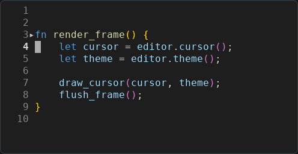
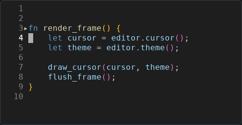
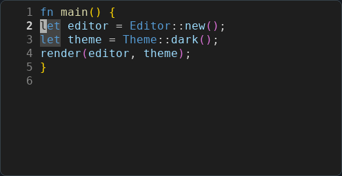
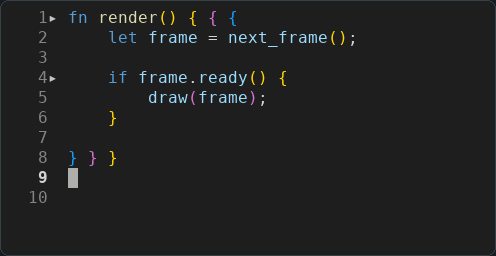
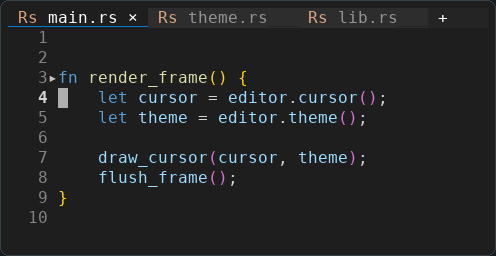

# Customization

Settings, keybindings, themes, syntaxes, language servers, formatters and animations.

## Settings and tools

Open **File → Settings…** for preferences or **File → Keyboard Shortcuts…** to
edit bindings. **Help → Keyboard Shortcut Reference** shows the quick reference.
**View** groups workspace views, panels, editor splits, and common display options;
additional appearance controls are in Settings and the command palette.
Syntax installation and reload are available through **Preferences: Install Syntax
from File** and **Developer: Reload Syntaxes** in the command palette.

- **Settings:** use **User** for defaults and **Workspace** for project overrides; edit through the UI or JSON.
- **File types:** click the status bar language → **Configure File Associations…**, or open **Settings → Files → File Associations**. Map extensions (`*.h`) or filenames (`Jenkinsfile`) to a language globally or per workspace; edit or remove rules in the same dialog. Applies to highlighting, LSP, and formatter selection.
- **Content detection:** files without a recognized name or extension are classified in the background by [Magika](https://github.com/google/magika), using its embedded model and confidence thresholds. Only bounded samples of the open buffer's beginning and end are inspected, including for remote files; detection makes no disk or network requests. Manual language choices and file associations take precedence, and uncertain content stays plain text.
- **Themes:** choose from 29 built-in palettes in **Settings → Workbench → Appearance → Color Theme**, including One Dark Pro, Dracula, GitHub Dark, Tokyo Night, Catppuccin, Nord, Night Owl, Ayu, Rosé Pine, and Gruvbox. All built-ins work offline; see the [full catalog and sources](../themes/SOURCE.md). To add more, run **Preferences: Install Color Theme from File or Link** and paste a [VS Code Themes](https://vscodethemes.com/) link or a local `.vsix` path. Use **Delete…** beside an installed variant (or the Delete key) and confirm to remove it. Bundled themes are protected. Removals persist; reinstalling a pack restores its removed variants.
- **Syntaxes:** run **Preferences: Install Syntax from File** with a local TextMate `.tmLanguage.json` or `.tmLanguage` file. Highlighting reloads automatically; URLs are not accepted. All languages use the same native TextMate tokenizer and VS Code theme rules. Grammar sources live in the root [grammars](../grammars/README.md) directory: `grammars/bundled` is compiled into the executable, and the Rust, Python, and Git folders hold the VS Code overrides. Portable releases ship these assets in `grammars/` beside the executable.
- **Agents:** install an ACP-compatible agent separately, then run **Agent: Configure Agents** from the command palette.
- **Extensions:** install through **Extensions: Install Extension from GitHub**. See the [Wasm extension guide](../extension-api/README.md) to build your own.
- **Performance & activity:** pin the live monitor while you work: CPU/memory trends, UI responsiveness, slow calls, worker queues, task timings, and workspace details. Resource sampling runs at most every 10 seconds while visible and the app is focused.

## Language servers

Install a language server separately, then open **Settings → Language Servers →
Manage Servers** or click **LSP** in the status bar. Add its language ID,
executable, file patterns, and arguments. Choose **User** or **Workspace** settings;
the workspace server list overrides the user list.

Use Pyright for Python, clangd for C/C++, or another server supporting LSP over
stdin/stdout. Diagnostics wait for a pause in typing;
adjust **Diagnostic Delay (ms)** in Language Servers settings.

## Formatters

**Formatting is independent of LSP.** The first format request asks for a formatter
per language and remembers the choice. Use **External Command** for tools such as
Black, or **Language Server** for servers such as clangd. External tools must be installed
separately. Change the choice through **Configure Formatter…** in the command
palette or **Settings → Files → Formatters → Configure…**.
External commands can edit a temporary file or return formatted text on stdout.
File mode starts with `{file}` as an argument, includes unsaved edits, and applies
formatting as one undoable change; it writes the original file only on Save.

## Shortcut contexts

In **Keyboard Shortcuts**, select a binding and choose **When** to restrict it
to a context. Leave the condition blank to make the binding unconditional.
Different commands can share a key when their conditions differ. Workspace rules
take priority over User rules. Later rules in the same list win when both match.
Conditions use the current focus, including on the second stroke of a chord.

Common conditions include `editorTextFocus`, `editorHasSelection`,
`terminalFocus`, `terminalAltScreen`, `filesExplorerFocus`, `searchInputFocus`,
`searchResultsFocus`, `findInputFocus`, `settingsFocus`, and `chatFocus`.
Use `!`, `&&`, `||`, and parentheses to combine them. You can also compare
values, for example `editorLangId == rust`, `resourceExtname =~ /^\.(log|txt)$/i`,
or `editorTabCount > 1`.

**Ctrl+Shift+T** reopens the last closed tab from the editor or a regular
integrated terminal. Fullscreen terminal applications receive the key by default.
To limit it to the file editor, set its **When** to `editorTextFocus`. The same
override is available in User or Workspace settings JSON.

```json
{
  "keybindings": [
    { "command": "reopen_closed", "when": "editorTextFocus" }
  ]
}
```

Omitting `key` keeps the inherited shortcut. Existing key-only overrides
inherit their condition.

## Animations

**Sliding Tabs** is enabled by default with a **250 ms** duration. Other effects
are off by default; configure them in **Settings → Animations**.
**Sliding Tabs** animates reordered tabs and their displaced neighbors, as well
as the active underline when switching tabs. Repeated reorders continue from
the current motion, and the duration and intensity controls apply to both.
Cursor Smear, Fire Hazard, Whitespace Reveal, and Scope Bubble pause during
multicursor editing. **Cursor Smear** follows navigation when enabled. Check
**Apply cursor smear when typing** to extend it to edits. This is off by default.
**Scope Bubble: Background Fill** adds animated shading
after the scope outline finishes drawing.
**Scope Bubble: Language Rules** lets you choose a parsing style and delimiter
pairs (`{}`, `()`, `[]`) per language, with User and Workspace overrides.
For example, use C++ scopes for a custom syntax or add parentheses to C++.
Cosmetic redraws adapt to rendering speed on slower computers, leaving time
for input; the configured FPS remains the upper limit.

<table>
  <tr>
    <td align="center">
      <strong>Cursor Smear</strong><br>
      
    </td>
    <td align="center">
      <strong>Fire Hazard</strong><br>
      
    </td>
  </tr>
  <tr>
    <td align="center">
      <strong>Whitespace Reveal</strong><br>
      
    </td>
    <td align="center">
      <strong>Scope Bubble</strong><br>
      
    </td>
  </tr>
  <tr>
    <td colspan="2" align="center">
      <strong>Sliding Tabs</strong><br>
      
    </td>
  </tr>
</table>

---

[← Back to README](../README.md)
