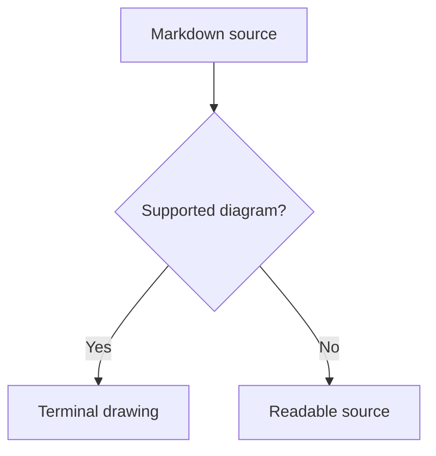
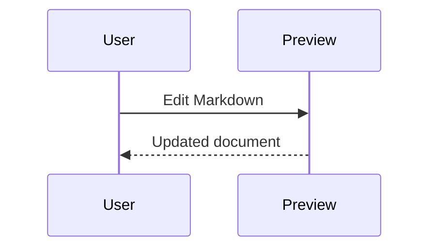
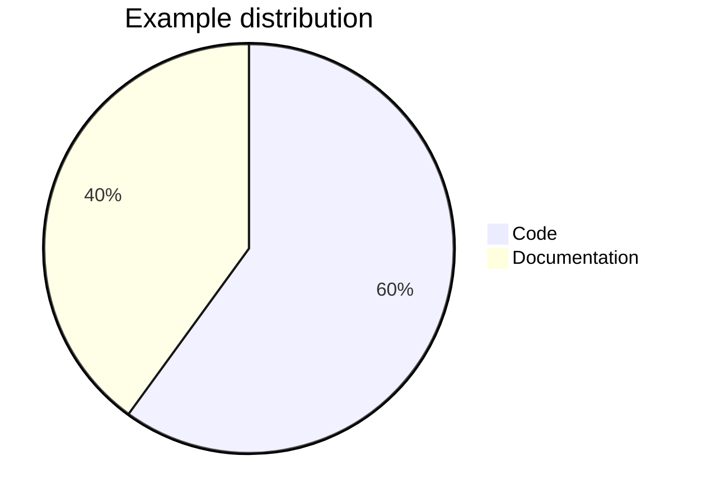

# Markdown, beautifully readable

A live preview for **clear thinking**, *good documentation*, and `great code`.
Nested styles work too: **strong words with *a little emphasis***.

## Everything in its place

- [x] Rich typography and ~~retired ideas~~
- [x] Tables, code, and nested lists
- [ ] Ship something worth reading
  - Keep details close to the idea
  - Let long descriptions wrap naturally beneath their bullet

> [!TIP]
> Write in the source tab and watch the preview update.
> **Small details matter:** spacing, contrast, and a comfortable reading width.

## A little structure

| Feature | Support | Notes |
| :--- | :---: | ---: |
| **Tables** | Ready | Aligned columns |
| Task lists | Ready | Checked & unchecked |
| Unicode | Ready | café · 世界 · 👩‍💻 |

## Code that feels at home

```rust
fn main() {
    let message = "Hello, Markdown!";
    println!("{message}");
}
```

### Links, references & footnotes

Read the [CommonMark specification][spec] or add a useful footnote.[^note]
Images have a readable terminal fallback: .

[spec]: https://spec.commonmark.org/

[^note]: Footnotes support **formatting**, too.

---

A final thought  
with an intentional line break.

## Diagrams and equations







Inline math: $E = mc^2$, $\alpha + \beta$, and $\frac{1}{2}$.

$$
\sum_{k=1}^{n} k = \frac{n(n+1)}{2}
$$

!!! tip "Navigation"
    **Ctrl+Click** [this heading](#diagrams-and-equations) or a footnote to jump there.

<details>
<summary>Readable HTML</summary>
<p>Common <strong>HTML formatting</strong> works too, including H<sub>2</sub>O.</p>
</details>
